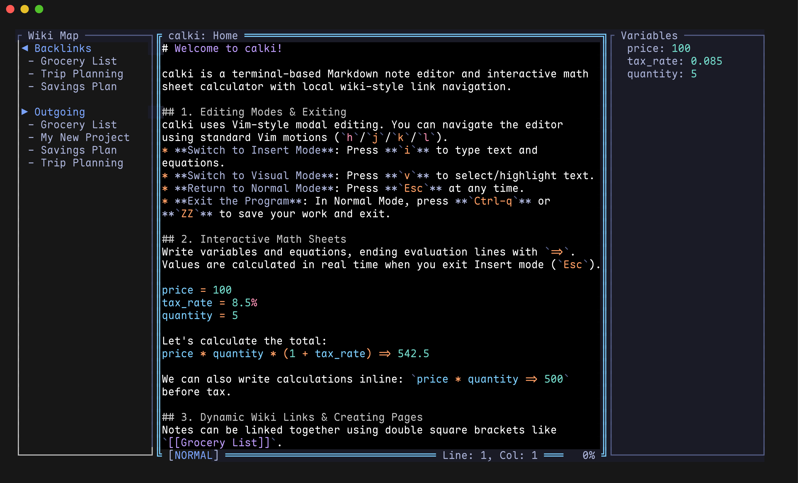
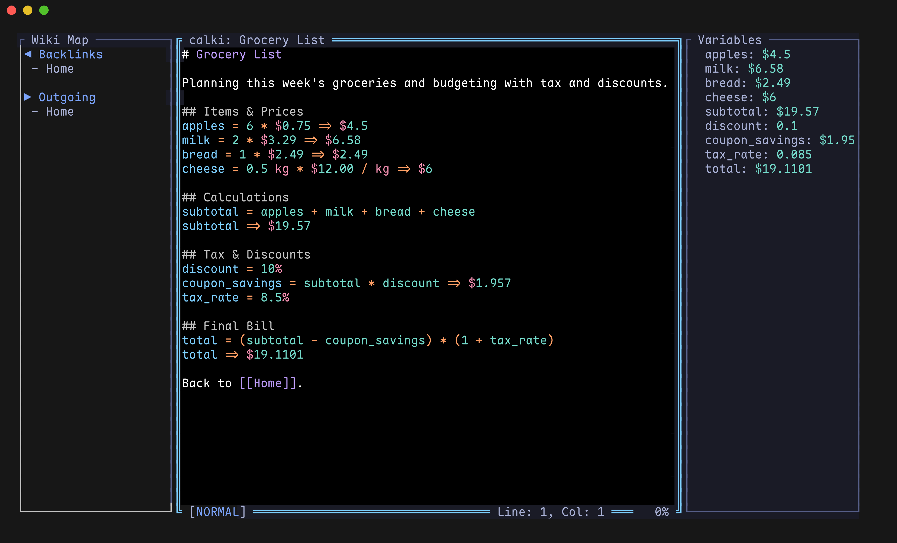
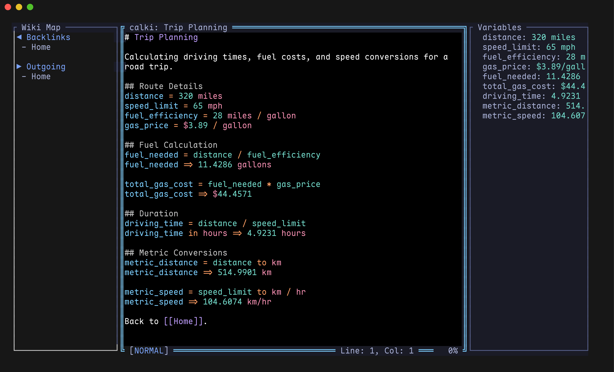

# calki

A terminal Markdown editor with a live calculator and wiki-style links built in. Write notes, do the math inside them, and link them together — without leaving the keyboard.



---

## Features

### Live math in your notes

Write an expression, end the line with `=>`, and calki evaluates it the moment you leave Insert mode. The same works inline inside a sentence with backticks: `` `10m * 5m =>` ``.



The calculation engine goes well past arithmetic:

- **Algebra & calculus** — symbolic differentiation (`diff`) and equation solving (`solve`) by rearrangement, algebraic inversion, or Newton-Raphson with an optional initial guess.
- **Statistics** — `mean`, `median`, `stddev`, `variance`, `sum`, `min`, `max`.
- **Vectors & matrices** — `[[1, 2], [3, 4]]` with `*`, `transpose`, `det`, `inv`, and linear systems via `linsolve(A, b)`.
- **Programming constructs** — `map`, `filter`, `reduce`, `zip`, `for`/`while` loops, and conditionals.
- **Finance** — `pmt`, `fv`, `pv`.
- Complex numbers, hex and binary literals, and inline `sparkline`s.

### Units, currency, and units you invent

Dimensional analysis covers length, speed, data size, temperature, and time, alongside live currency conversion (rates are fetched in the background, so startup stays instant).

You can also invent your own units with plain physics-style equivalences:

```
1 jabberwock = 2 jumjumtrees
200 jumjumtrees = 7 bandersnatch
100 jabberwock to bandersnatch   => 7 bandersnatch
```

Chains convert in either direction even when nothing is anchored to a real unit. Tie an invented unit to a built-in one (`1 jabberwock = 2 meters`) and the whole system grounds into SI — so it converts to `ft`, `km`, and everything else. Contradictory definitions are reported as errors.

### Dates, times, and timezones

Native date/time values (`2026-08-01`, `2026-08-01T09:30`, `9am`, `9:30pm`) with calendar-aware arithmetic:

```
2026-08-01 + 3 days          => 2026-08-04
2026-08-04 - 2026-08-01      => 3 days
2024-01-31 + 1 month         => 2024-02-29          (leap-safe, end-of-month clamped)
2026-01-15T09:00 PST in UTC  => 2026-01-15T17:00
```

Timezone conversion is DST-correct and understands IANA names (`America/New_York`), common abbreviations, and `UTC±N` offsets. `now()` and `today()` are available too.

### Notes and navigation

- **Wiki links** — connect notes with `[[Project Goals]]`. Press `Enter` on a link to follow it, `Backspace` or `Ctrl-o` to go back. Following a link to a note that doesn't exist creates it.
- **Open any file, switch trees** — `:e <path>` edits any file, inside your wiki or not (created if new); `:wiki <dir>` switches to another wiki tree for the session. Links and backlinks always resolve relative to the file you're editing.
- **Concealed markup** — `:conceal on` hides the backticks around `` `inline code` `` on every line except the one you're editing, which always shows the raw text. `:conceal off` brings them back; bare `:conceal` toggles. The setting is saved (config key `conceal`).
- **Section folding** — `za` or `Tab` on a header folds everything beneath it down to the next header of the same level, shown as `▶ # Section (N lines folded)`. Folds nest, survive edits, and Vim motions step over them.
- **Todo checkboxes** — `t` on a list line toggles `[ ]` ⇄ `[x]`, or turns a plain bullet into a checkbox.
- **Custom functions** — define `f(x) = x^2 + 2*x` in a note and reuse it anywhere in that file; defined functions appear in the Variables panel.



### Interface

- **Three panels** — a Wiki Map (references and backlinks) on the left, the `edtui`-powered Vim editor in the center, and a Variables Inspector (live scopes and results) on the right.
- **Export** — `Ctrl-e` compiles the current note to HTML, or the whole wiki to a single Markdown file.
- **Persistent sessions** — panel layout, cursor position, and preferences are saved between runs.
- **Update checks** — calki checks GitHub for new releases on launch, without blocking startup, and lets you skip a version you don't want.

---

## Installation

calki needs the Rust toolchain. If you don't have it, install it with [rustup](https://rustup.rs/):

```bash
curl --proto '=https' --tlsv1.2 -sSf https://sh.rustup.rs | sh
```

### From crates.io

```bash
cargo install calki
```

This installs the binary to `~/.cargo/bin/`; run it from anywhere with `calki`.

### From source

```bash
git clone https://github.com/kemika180/calki.git
cd calki
cargo install --path .    # or: cargo run --release
```

### Updating

Re-run the install command to pick up the latest version — `cargo install calki`, or `cargo install --path .` after a `git pull origin main`.

---

## Keybindings

calki uses Vim-style modal editing: the standard motions (`h` `j` `k` `l` `w` `b` …) work, and repeatable motions take a count (`5j` down five lines, `12w` forward twelve words, `3x` delete three characters).

### Panels

| Key | Action |
| --- | --- |
| `F2` | Toggle the left panel (Wiki Map) |
| `F3` | Toggle the right panel (Variables Inspector) |
| `Ctrl-h` / `Shift-H` | Focus the panel to the left |
| `Ctrl-l` / `Shift-L` | Focus the panel to the right |
| `F1` | Toggle the Help & Math Function guide |

### Global

| Key | Action |
| --- | --- |
| `/` | Search the wiki for a keyword |
| `:` | Open the command line (`:e`, `:wiki`, `:theme`, `:conceal`, `:q`) |
| `Ctrl-s` | Save the current note |
| `Ctrl-e` | Open the export menu (HTML / Markdown) |
| `F4` | Toggle word wrap |
| `Ctrl-q` / `ZZ` | Save and quit |

### Editing — Normal mode

| Key | Action |
| --- | --- |
| `Enter` | Follow the `[[wiki link]]` under the cursor (creates the note if missing) |
| `Backspace` / `Ctrl-o` | Go back in history |
| `t` | Toggle a todo checkbox, or turn a list bullet into one |
| `Ctrl-d` | Delete the current note (with confirmation) |
| `za` / `Tab` | Fold or unfold the header section at the cursor |

### Editing — Visual mode

| Key | Action |
| --- | --- |
| `>` / `<` | Indent / dedent the selected lines |
| `Enter` | Wrap the selection in a `[[wiki link]]` |

---

## Configuration

calki reads `config.json` from your OS config directory (`~/.config/calki/` on Linux and macOS):

| Key | Type | Default | Description |
| --- | --- | --- | --- |
| `theme` | string | `"tokyo-night"` | Color theme. Switch live with `:theme <name>`; custom themes live in `~/.config/calki/themes/`. |
| `scrolloff` | integer | `5` | Lines kept visible above and below the cursor while scrolling. |
| `line_numbers` | string | `"None"` | Line numbering: `"None"`, `"Absolute"`, or `"Relative"`. |
| `word_wrap` | boolean | `true` | Wrap long lines instead of scrolling horizontally. Toggle live with `F4`. |
| `conceal` | boolean | `false` | Hide the backticks around `` `inline code` `` on every line except the cursor's. Fenced code blocks are left as typed. Toggle live with `:conceal`. |
| `mouse_focus_on_hover` | boolean | `true` | Focus a panel on hover rather than requiring a click. |
| `expand_variables_on_select` | boolean | `false` | Expand the Variables panel to full names and values when it's focused. |

```json
{
  "theme": "tokyo-night",
  "scrolloff": 5,
  "line_numbers": "None",
  "word_wrap": true,
  "conceal": false,
  "mouse_focus_on_hover": true,
  "expand_variables_on_select": false
}
```

---

## License

Licensed under GPL v3. See [LICENSE](LICENSE) for details.
